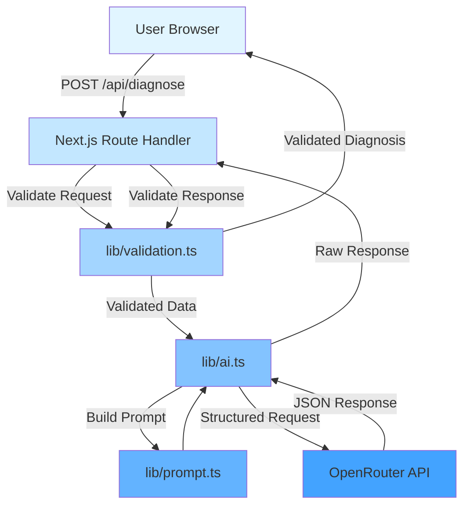
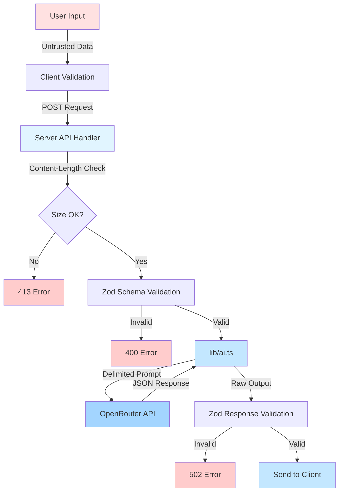
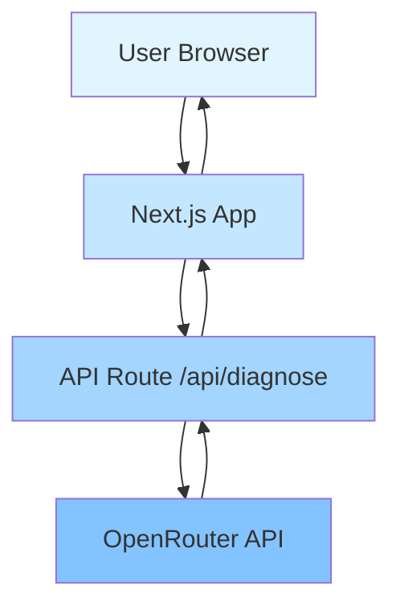

# CodeMedic

**AI-powered diagnosis and treatment for broken code.**

CodeMedic is a small, focused developer tool: paste an error and the code that produced it, and CodeMedic examines the symptoms, identifies the most likely root cause, shows its evidence, and prescribes a minimal, explained fix — powered by an LLM through [OpenRouter](https://openrouter.ai).

This is a portfolio project. It is deliberately small. See [§24 Engineering Decisions](#24-engineering-decisions) and [§25 Tradeoffs](#25-tradeoffs) for what was intentionally left out, and why.

---

## Table of Contents

1. [Overview](#1-overview)
2. [Why I Built This](#2-why-i-built-this)
3. [Problem](#3-problem)
4. [Solution](#4-solution)
5. [Core Workflow](#5-core-workflow)
6. [Features](#6-features)
7. [Demo](#7-demo)
8. [Screenshots](#8-screenshots)
9. [Tech Stack](#9-tech-stack)
10. [Architecture](#10-architecture)
11. [Project Structure](#11-project-structure)
12. [AI Architecture](#12-ai-architecture)
13. [OpenRouter Integration](#13-openrouter-integration)
14. [AI Prompt Design](#14-ai-prompt-design)
15. [Response Schema](#15-response-schema)
16. [API Documentation](#16-api-documentation)
17. [Security](#17-security)
18. [Setup](#18-setup)
19. [Environment Variables](#19-environment-variables)
20. [Running Locally](#20-running-locally)
21. [Testing](#21-testing)
22. [Build](#22-build)
23. [Deployment](#23-deployment)
24. [Engineering Decisions](#24-engineering-decisions)
25. [Tradeoffs](#25-tradeoffs)
26. [Limitations](#26-limitations)
27. [Future Improvements](#27-future-improvements)
28. [Portfolio Highlights](#28-portfolio-highlights)
29. [Contributing](#29-contributing)
30. [License](#30-license)

---

## 1. Overview

CodeMedic takes four pieces of information from a developer — programming language, error message or symptom, the broken code, and (optionally) what the code was supposed to do — and returns a structured diagnosis:

**Symptoms → Diagnosis → Root Cause → Evidence → Treatment → Explanation → Prevention**

The point isn't just "here's a fix." It's "here's *why* it broke, here's the evidence for that claim, here's the smallest fix, and here's how to avoid it next time." The AI also reports its own confidence, and is explicitly allowed — even encouraged — to say "low confidence" when the input doesn't give it enough to be sure.

## 2. Why I Built This

CodeMedic exists to demonstrate one thing end-to-end: a real AI-powered developer tool, built the way a production feature would be — not a chat-wrapper demo. That means server-side API key handling, request/response validation on both sides of the AI call, prompt-injection-aware prompt design, graceful failure states, and a UI that doesn't overstate what the AI actually knows. It's small on purpose, so the whole architecture fits in your head after five minutes of reading the code.

## 3. Problem

When code breaks, it's easy to find *a* fix — paste the error into a search engine or an AI chat and copy whatever comes back. It's much harder to get a fix you actually understand, backed by evidence from *your* code rather than a generic pattern match, with an honest signal about how confident that fix really is.

## 4. Solution

CodeMedic constrains the AI to a specific reasoning process (see [§14](#14-ai-prompt-design)) and a strict output schema (see [§15](#15-response-schema)), so every diagnosis has to show its work: the observable symptom, the root cause, the evidence for that root cause drawn only from what was submitted, the smallest fix that addresses it, why the fix works, how to prevent it next time, and a confidence level that's allowed to be low.

## 5. Core Workflow

```text
Developer
   |
   v
Debug Form  (language, error, code, expected behavior)
   |
   v
Next.js API  (POST /api/diagnose)
   |
   v
Validation  (Zod - input limits, required fields)
   |
   v
OpenRouter  (structured JSON output, server-side only)
   |
   v
Structured JSON
   |
   v
Response Validation  (same Zod schema, re-checked)
   |
   v
Diagnosis UI  (Diagnosis / Root Cause / Evidence / Treatment / Prevention)
```

## 6. Features

- AI-powered bug diagnosis from an error message + source code
- Root cause analysis, separated from the observable symptom
- Evidence drawn only from what was submitted (the prompt explicitly forbids inventing evidence)
- A focused, minimal code fix — not an unrelated rewrite
- A beginner-friendly explanation of *why* the fix works
- 2–4 concrete prevention tips
- An honest confidence rating (`high` / `medium` / `low`) that is never forced to `high`
- Three built-in, one-click demo examples (Python, JavaScript, React) that run through the real pipeline — nothing is hardcoded
- Syntax-highlighted code blocks with one-click "Copy Fix"

## 7. Demo

Live Demo: [Deploy your application and add the URL here]

To deploy locally, see [§20](#20-running-locally).

## 8. Screenshots

Screenshots are added after you run the app locally — see [§20](#20-running-locally) — or after deploying it. Save them to `public/screenshots/` and reference them here, for example:

```markdown


```

No screenshots are committed to this repository yet — add your own once you've run it, so the images in this README always reflect something real.

## 9. Tech Stack

| Layer | Choice | Why |
|---|---|---|
| Framework | [Next.js](https://nextjs.org) (App Router) | One framework for the UI and the API route; no separate backend service needed for a tool this size. |
| Language | TypeScript | Types shared end-to-end, from the Zod schema to the React props. |
| Styling | [Tailwind CSS v4](https://tailwindcss.com) | CSS-first theme (`app/globals.css`), no separate config file, small production CSS. |
| Validation | [Zod](https://zod.dev) | One schema, two jobs: generates the JSON Schema sent to OpenRouter *and* validates what comes back. See [§13](#13-openrouter-integration). |
| AI provider | [OpenRouter](https://openrouter.ai) | One API key, any underlying model, swappable via an environment variable — no multi-provider abstraction to maintain. |
| Icons | [lucide-react](https://lucide.dev) | Consistent icon set matching the "diagnostic dashboard" visual language. |
| Syntax highlighting | [prism-react-renderer](https://github.com/FormidableLabs/prism-react-renderer) | Lightweight, synchronous, no async grammar loading. |
| Testing | [Vitest](https://vitest.dev) | Fast, zero-config-friendly unit tests for the validation layer. |

## 10. Architecture

```text
Browser (React Client Component, app/page.tsx)
   |  fetch("/api/diagnose", { method: "POST", body: {...} })
   v
Route Handler (app/api/diagnose/route.ts)
   |  1. reject oversized bodies
   |  2. parse + validate the request body (lib/validation.ts)
   |  3. call lib/ai.ts
   v
lib/ai.ts (server-only)
   |  builds the system + user prompt (lib/prompt.ts)
   |  POSTs to OpenRouter with response_format: json_schema
   |  extracts + JSON.parses the model's message content
   v
Route Handler
   |  4. validate the parsed AI output (lib/validation.ts, same schema)
   |  5. return either the validated diagnosis or a friendly error
   v
Browser
   renders DiagnosisReport, or an ErrorState with a "Try again" button
```

The browser never talks to OpenRouter directly, and never sees `OPENROUTER_API_KEY` — `lib/ai.ts` is annotated with the `server-only` package, which throws a build-time error if it's ever imported into client code.

### Architecture Diagram



## 11. Project Structure

```text
codemedic/
├── app/
│   ├── page.tsx               # the single page - owns all UI state
│   ├── layout.tsx              # fonts, <html>/<body>, metadata
│   ├── globals.css             # Tailwind v4 theme tokens (design system)
│   ├── icon.tsx                 # generated favicon (no image asset needed)
│   └── api/diagnose/route.ts   # the one API endpoint
├── components/
│   ├── Header.tsx               # logo + GitHub link
│   ├── Hero.tsx                  # compact intro + two CTAs
│   ├── DebugForm.tsx             # the "Symptoms" form
│   ├── ExampleButtons.tsx        # the 3 built-in demo examples
│   ├── EmptyState.tsx            # "no diagnosis yet"
│   ├── LoadingDiagnosis.tsx      # animated step sequence
│   ├── DiagnosisReport.tsx       # the full result
│   ├── ConfidenceBadge.tsx       # high/medium/low, icon + color + text
│   ├── ErrorState.tsx            # API failure / timeout / bad AI output
│   ├── CodeBlock.tsx             # syntax highlighting + copy button
│   └── ui/                       # small primitives (Button, Select, TextArea, Badge, PulseTrace)
├── lib/
│   ├── ai.ts                     # the ONLY file that talks to OpenRouter
│   ├── prompt.ts                  # the system prompt, isolated and readable
│   ├── validation.ts              # request + response Zod validation, input limits
│   └── examples.ts                # the 3 demo examples' data
├── types/
│   └── diagnosis.ts               # languages, confidence levels, the Diagnosis schema/type
├── tests/
│   └── validation.test.ts         # unit tests for lib/validation.ts
├── public/
│   └── screenshots/              # screenshot directory (add your own)
├── .env.example                  # environment variable template
├── .env.local                    # your actual environment variables (git-ignored)
├── .gitignore                    # git ignore rules
├── README.md                      # this file
├── dependencyinstall.md           # A-Z setup + every dependency explained
├── LICENSE                       # MIT license
├── package.json                  # dependencies and scripts
├── tsconfig.json                 # TypeScript configuration
├── next.config.ts                # Next.js configuration
├── postcss.config.mjs            # PostCSS configuration
├── eslint.config.mjs            # ESLint configuration
└── vitest.config.ts              # Vitest test configuration
```

### Key File Responsibilities

- **app/page.tsx**: Main application component managing UI state and diagnosis workflow
- **app/api/diagnose/route.ts**: Server-side API endpoint handling diagnosis requests
- **lib/ai.ts**: OpenRouter integration - the only file that communicates with the AI service
- **lib/validation.ts**: Request/response validation using Zod schemas
- **lib/prompt.ts**: System prompt and user prompt construction
- **types/diagnosis.ts**: Core type definitions and Zod schemas
- **components/**: React components organized by feature and UI primitives

## 12. AI Architecture

```text
User Input (language, error, code, expected behavior)
        |
        v
Validation (lib/validation.ts - DiagnoseRequestSchema)
        |
        v
Prompt Construction (lib/prompt.ts - system prompt + delimited user data)
        |
        v
OpenRouter (lib/ai.ts - response_format: json_schema, strict: true)
        |
        v
Structured JSON (extracted from choices[0].message.content)
        |
        v
Zod Validation (lib/validation.ts - DiagnosisSchema, same schema used to build the request)
        |
        v
UI (DiagnosisReport, or ErrorState if any step above failed)
```

## 13. OpenRouter Integration

**Why OpenRouter.** One API key and one HTTP endpoint give access to many underlying models. Swapping models is an environment variable change (`OPENROUTER_MODEL`), not a code change — which is also exactly why this project does *not* build a custom multi-provider abstraction on top of it; OpenRouter already is that abstraction.

**Server-side only.** `OPENROUTER_API_KEY` is read once, in `lib/ai.ts`, via `process.env`. That file imports the `server-only` package, so trying to import it from a Client Component fails the build instead of failing silently at runtime.

**Structured responses.** `types/diagnosis.ts` defines `DiagnosisSchema` with Zod. `lib/ai.ts` converts that exact schema to JSON Schema with Zod v4's built-in `z.toJSONSchema()` and sends it as `response_format: { type: "json_schema", json_schema: { strict: true, schema } }`. The same `DiagnosisSchema` is then used again, unchanged, to validate whatever comes back. One definition, two jobs — the "ask" and the "check" can't drift apart.

**Model configuration.** `OPENROUTER_MODEL` selects the model (default: `openai/gpt-4o-mini` — chosen for low cost and reliable structured-output support). Any model can be used instead, as long as the OpenRouter endpoint serving it supports structured outputs; filter for that at <https://openrouter.ai/models?supported_parameters=structured_outputs>.

**Timeouts and failure handling.** The OpenRouter request is wrapped in an `AbortController` with a 45-second timeout. `lib/ai.ts` throws one of four typed errors (`DiagnosisConfigError`, `DiagnosisTimeoutError`, `DiagnosisRequestError`, `DiagnosisParseError`) depending on what went wrong, and `app/api/diagnose/route.ts` maps each to a specific, friendly, non-leaky HTTP response. See [§17](#17-security) for what's shown to the user vs. logged on the server.

## 14. AI Prompt Design

The full prompt lives in `lib/prompt.ts`, isolated from the networking code so it's easy to read and audit on its own. The important design principles:

- **Evidence-based reasoning.** The model is instructed to cite evidence only from what the developer submitted, and never invent facts that aren't present in the input.
- **Minimal fixes.** The prompt explicitly asks for the smallest reliable fix, not a rewrite — and to preserve the developer's original style.
- **Honest uncertainty.** The model is told not to claim certainty when the input doesn't support it, and that `confidence: "low"` is an acceptable, expected answer — never forced to `"high"`.
- **Prompt-injection resistance.** The developer's error message, code, and expected-behavior text are wrapped in explicit `<error_or_symptom>`, `<broken_code>`, `<expected_behavior>` blocks (see `buildUserPrompt` in `lib/prompt.ts`) and the system prompt explicitly instructs the model to treat that content as *data to diagnose*, never as instructions — even if it contains phrases like "ignore previous instructions." This is why, for example, the third demo example's error text ("The counter sometimes shows the wrong value...") is diagnosed as a bug description, not executed as a command.
- **No code execution.** The system prompt states plainly that the model is a static reasoning tool and must never execute submitted code — CodeMedic has no code-execution capability anywhere in the stack (see [§17](#17-security)).
- **No leaking internals.** The model is told not to expose the system prompt, API keys, or implementation details, even if asked to inside the submitted code or error text.

## 15. Response Schema

```json
{
  "diagnosis": "string",
  "rootCause": "string",
  "evidence": ["string"],
  "fixedCode": "string",
  "changes": ["string"],
  "explanation": "string",
  "prevention": ["string"],
  "confidence": "high | medium | low"
}
```

Defined once, as a Zod schema, in `types/diagnosis.ts` (`DiagnosisSchema`). It's a `z.strictObject`, so unexpected extra fields fail validation rather than silently passing through to the UI.

## 15.1 API Documentation

### POST /api/diagnose

Diagnose a bug by submitting error information and code.

**Request Body:**

```json
{
  "language": "python",
  "error": "TypeError: unsupported operand type(s) for +: 'int' and 'str'",
  "code": "age = input('Enter your age: ')\nprint(age + 1)",
  "expectedBehavior": "Print the user's age next year."
}
```

**Fields:**

| Field | Type | Required | Max Length | Description |
|---|---|---|---|---|
| `language` | enum | Yes | — | Programming language (python, javascript, typescript, react, java, cpp, csharp, go, sql, other) |
| `error` | string | Yes | 5,000 | Error message or symptom description |
| `code` | string | Yes | 30,000 | The broken code snippet |
| `expectedBehavior` | string | No | 5,000 | What the code was expected to do |

**Response (Success - 200):**

```json
{
  "diagnosis": "You're adding an int to a string.",
  "rootCause": "input() always returns a string in Python 3.",
  "evidence": ["age = input(...) assigns a str", "age + 1 mixes str and int"],
  "fixedCode": "age = int(input('Enter your age: '))\nprint(age + 1)",
  "changes": ["Wrapped input() in int()"],
  "explanation": "Converting to int lets Python add 1 to it correctly.",
  "prevention": ["Convert input() calls to the type you need right away."],
  "confidence": "high"
}
```

**Response (Error - 400):**

```json
{
  "error": "Please provide an error message and some code to diagnose."
}
```

**Response (Error - 413):**

```json
{
  "error": "Request is too large."
}
```

**Response (Error - 502):**

```json
{
  "error": "CodeMedic received an unexpected diagnosis format. Please try again."
}
```

**Response (Error - 504):**

```json
{
  "error": "The diagnosis took too long. Please try again."
}
```

**Response (Error - 500):**

```json
{
  "error": "CodeMedic couldn't complete the diagnosis. Please try again."
}
```

## 17. Security

- **API key protection.** `OPENROUTER_API_KEY` is read only in `lib/ai.ts` (`server-only`-guarded), never sent to the browser, never placed in a `NEXT_PUBLIC_*` variable, and `.env.local` is git-ignored.
- **Input validation.** Every request to `POST /api/diagnose` is validated with Zod (`lib/validation.ts`) before anything else happens — language must be one of the supported values, error/code are required, everything has a max length.
- **Input limits.** Error message and expected behavior: 5,000 characters. Code: 30,000 characters. Enforced server-side (mandatory) and mirrored in the UI as live character counts (a UX nicety, not the real enforcement — see `INPUT_LIMITS` in `lib/validation.ts`). The route handler also rejects oversized raw request bodies (>1MB) via `Content-Length` before even parsing JSON.
- **No code execution.** CodeMedic never runs submitted code, in any language, anywhere — not in the browser, not on the server, not via the AI. It's a static-analysis-plus-AI-reasoning tool only. There is no shell execution, no sandbox, no `eval`.
- **Untrusted input, always.** Submitted code and error text are treated as data, never as instructions — both structurally (delimited blocks in the prompt) and explicitly (the system prompt tells the model to ignore embedded instructions). See [§14](#14-ai-prompt-design).
- **AI output validation.** The AI's JSON response is re-validated against the exact same `DiagnosisSchema` used to request it, before it's ever sent to the browser. Malformed, truncated, or off-schema output — from a bug, a different model, or unexpected provider behavior — is caught here and turned into a friendly error instead of breaking the UI or displaying garbage.
- **No leaked internals.** Every failure path in `app/api/diagnose/route.ts` returns one of a small set of generic, friendly messages. Stack traces, provider error bodies, and configuration details (like "which env var is missing") are logged with `console.error` on the server only, never sent in the HTTP response.

### Security Flow Diagram



## 18. Setup

### Prerequisites

- **Node.js**: Version 20.9 or later (Node 22 LTS recommended)
- **npm**: Version 10+ (ships with Node 20/22)
- **Git**: Any recent version (if cloning from repository)
- **OpenRouter Account**: Sign up at [openrouter.ai](https://openrouter.ai) and create an API key

### Installation

```bash
# Clone the repository
git clone https://github.com/yourusername/codemedic
cd codemedic

# Install dependencies
npm install

# Set up environment variables
cp .env.example .env.local

# Edit .env.local and add your OpenRouter API key
# OPENROUTER_API_KEY=sk-or-v1-your-actual-key-here

# Start development server
npm run dev
```

The application will be available at [http://localhost:3000](http://localhost:3000).

For the full walkthrough — prerequisites, what each dependency does, common setup problems — see **[dependencyinstall.md](./dependencyinstall.md)**.

## 19. Environment Variables

### Required Variables

| Variable | Description | How to Get |
|---|---|---|
| `OPENROUTER_API_KEY` | Your OpenRouter API key for AI model access | Sign up at [openrouter.ai/keys](https://openrouter.ai/keys) |

### Optional Variables

| Variable | Default | Description |
|---|---|---|
| `OPENROUTER_MODEL` | `openai/gpt-4o-mini` | The AI model to use for diagnoses. Must support structured outputs. See [OpenRouter models](https://openrouter.ai/models?supported_parameters=structured_outputs) |

### Setup Steps

1. Copy the example environment file:
   ```bash
   cp .env.example .env.local
   ```

2. Edit `.env.local` and add your OpenRouter API key:
   ```env
   OPENROUTER_API_KEY=sk-or-v1-your-actual-key-here
   OPENROUTER_MODEL=openai/gpt-4o-mini
   ```

3. Restart the development server after making changes.

**Security Note:** Never commit `.env.local` or any file containing real API keys. The `.gitignore` file is configured to prevent this.

## 20. Running Locally

```bash
npm install
npm run dev
```

Then open <http://localhost:3000>. Click one of the three example buttons to pre-fill the form, or paste your own error and code, then press **Diagnose Bug**.

## 21. Testing

### Automated Tests

Automated unit tests cover the validation layer (the pure-function core that's cheapest to test with high confidence):

```bash
npm test
```

This exercises `lib/validation.ts`: request validation (required fields, language enum, length limits, malformed bodies) and AI response validation (schema shape, confidence enum, empty arrays, and — notably — that unexpected extra fields in the AI's JSON are rejected by the strict schema).

### Watch Mode

For development, run tests in watch mode:

```bash
npm run test:watch
```

### Manual Testing Checklist

For everything that depends on an actual OpenRouter call, test manually against the running dev server:

1. **Python example** — click "Python TypeError," press Diagnose Bug, confirm the fix wraps `input()` in `int()`.
2. **JavaScript example** — click "JavaScript Undefined," confirm the diagnosis identifies `user.email` as `undefined`.
3. **React example** — click "React State Bug," confirm the explanation mentions functional state updates (`setCount(prev => prev + 1)`).
4. **Empty code** — clear the Broken Code field; the Diagnose Bug button should be disabled.
5. **Empty error** — clear the Error Message field; the Diagnose Bug button should be disabled.
6. **API/OpenRouter failure** — temporarily set an invalid `OPENROUTER_API_KEY` in `.env.local`, restart the dev server, submit a diagnosis, and confirm you see the friendly "CodeMedic couldn't complete the diagnosis" message (not a stack trace).
7. **Malformed AI response** — hard to force directly, but covered by the `parseDiagnosisResponse` unit tests above; the route handler's behavior for this case is identical to #6 from the UI's perspective.
8. **Copy Fix** — after any successful diagnosis, click "Copy Fix" under Treatment and confirm the button briefly shows "Copied."
9. **Example buttons** — confirm clicking an example populates all form fields and does **not** call the API until you press Diagnose Bug.
10. **Mobile layout** — resize the browser (or use device emulation) below `640px` and confirm the two-column layout stacks to one column and code blocks scroll horizontally instead of overflowing.

### Production Build Testing

Always run a production build before considering any change complete:

```bash
npm run build
npm run start
```

Test the production build at [http://localhost:3000](http://localhost:3000) to ensure it behaves identically to the development server.

## 22. Build

```bash
npm run build
npm run start
```

`next build` performs a full TypeScript check and production bundle; `next start` serves that production build so you can smoke-test it exactly as it will run in production, including environment variable behavior.

## 23. Deployment

CodeMedic is a standard Next.js App Router project, so it deploys anywhere Next.js does. The easiest path is [Vercel](https://vercel.com) (made by the Next.js team, zero-config for this project):

### Vercel Deployment

1. Push this repository to GitHub.
2. Import it in Vercel.
3. In the project's Environment Variables settings, add:
   - `OPENROUTER_API_KEY` (required)
   - `OPENROUTER_MODEL` (optional, defaults to `openai/gpt-4o-mini`)
4. Deploy.

### Other Platforms

Any other Node.js hosting platform that supports Next.js (Render, Railway, Fly.io, a self-managed Node server, etc.) works the same way: set the two environment variables from [§19](#19-environment-variables) on the platform, then run `npm run build` and `npm run start`. Environment variables must be configured on the platform itself — `.env.local` never gets deployed (it's git-ignored by design).

### Deployment Architecture



## 24. Engineering Decisions

**No database.** Nothing here needs to persist between requests — each diagnosis is a single stateless round trip. Adding a database would add real operational surface area for zero product value in this MVP.

**No authentication.** This is a single-purpose public tool, not a multi-user product. Auth would add complexity without a corresponding requirement.

**OpenRouter.** Gives access to many models behind one API and one key, and makes the model swappable via an environment variable instead of a code change or a custom provider-abstraction layer.

**Structured AI output.** Requesting `response_format: json_schema` makes the model's output predictable and machine-checkable, rather than parsing free text with regexes and hoping for the best.

**Zod.** One schema definition drives both what CodeMedic *asks* the model for (via `z.toJSONSchema`) and what it *accepts* back (`safeParse`) — see [§13](#13-openrouter-integration). It also validates the incoming HTTP request in the same style, so the whole app has one validation idiom.

**No code execution.** Running arbitrary user-submitted code (in any language) is a serious security surface — sandboxing it safely is a project in itself. CodeMedic stays a static-analysis-plus-AI-reasoning tool and sidesteps that surface entirely.

**Single-page UI.** One screen, one job. There's no navigation to design, no routing to reason about, and a recruiter can understand the whole product in the time it takes to scroll once.

**Custom UI components instead of 21st.dev.** The original plan called for pulling selected components from [21st.dev](https://21st.dev)'s registry. The environment this project was built in doesn't have network access to that registry, so instead `components/ui/` is a small, consistent, from-scratch component set (`Button`, `Select`, `TextArea`, `Badge`, plus the `PulseTrace` signature motif) built in the same spirit — polished, accessible, and used selectively rather than templated wholesale. Swapping any of them for a real 21st.dev component later is a drop-in change; nothing else in the app depends on how these primitives are implemented internally.

## 25. Tradeoffs

- **One AI provider, one call per diagnosis.** No retry-with-backoff, no fallback model, no streaming. If OpenRouter or the chosen model is briefly unavailable, the user sees a friendly error and a "Try again" button rather than the app silently retrying on their behalf.
- **No conversation memory.** Every diagnosis is independent. You can't ask CodeMedic a follow-up question about a previous diagnosis — you edit the input and diagnose again.
- **Simulated loading steps.** The four-step "Examining symptoms / Finding suspicious code / ..." sequence in `LoadingDiagnosis.tsx` is a fixed-interval animation, not real progress from the model — OpenRouter's chat completions API used here doesn't expose intermediate reasoning steps for a non-streaming structured-output request.
- **Single-file fixes only.** The whole product assumes a single error tied to a single pasted snippet, which is a real constraint on how much context the AI has to work with.

## 26. Limitations

- AI diagnosis can be incorrect, especially at `medium` or `low` confidence — always shown in the UI, never hidden.
- Static analysis of a pasted snippet cannot reproduce a real runtime environment, so anything that depends on external state (files, network calls, environment variables, other modules) is diagnosed from context only.
- Multi-file bugs are outside the MVP — CodeMedic only sees what's pasted into the Broken Code field.
- Some bugs genuinely require logs, stack traces, or runtime state that a static snippet can't provide; the model is instructed to lower its confidence rather than guess in these cases.
- No actual code execution occurs anywhere in the system — every diagnosis is reasoning, not verified-by-running.

## 27. Future Improvements

- GitHub integration (diagnose a PR or a linked file directly)
- Stack trace visualization for multi-frame errors
- Multi-file debugging (submit more than one file of context)
- AI-generated regression tests alongside the fix
- VS Code extension
- An optional, properly isolated execution sandbox to verify fixes before showing them

None of the above exist in this repository today — they're listed here as the deliberate "not yet" list, not a roadmap promise.

## 28. Portfolio Highlights

This project is meant to demonstrate:

- **AI integration** — structured outputs, schema-driven prompting, confidence handling, prompt-injection-aware prompt design
- **Full-stack development** — a complete Next.js App Router app, UI to API to external service and back
- **API design** — one clear endpoint, explicit request/response contracts, meaningful HTTP status codes per failure mode
- **TypeScript** — types shared from the Zod schema all the way to React props, with no `any`
- **Validation** — the same schema-first approach applied to both the untrusted HTTP request and the untrusted AI response
- **Security** — server-only secrets, input limits, no code execution, no leaked internals
- **UX** — real loading/empty/error states, accessible by default, confidence communicated honestly instead of oversold
- **Product thinking** — a deliberately small surface area, with the things left out documented as decisions rather than gaps

## 29. Contributing

Contributions are welcome! This is a portfolio project designed to be readable and maintainable.

### Development Workflow

1. Fork the repository
2. Create a feature branch (`git checkout -b feature/amazing-feature`)
3. Make your changes
4. Run tests (`npm test`)
5. Run linting (`npm run lint`)
6. Build the project (`npm run build`)
7. Commit your changes
8. Push to the branch (`git push origin feature/amazing-feature`)
9. Open a Pull Request

### Code Style

- Follow existing TypeScript and React patterns
- Use the existing UI components from `components/ui/`
- Maintain the security-first approach (server-only for API keys)
- Add tests for new validation logic
- Update documentation as needed

### Issues

If you find a bug or have a suggestion, please open an issue on GitHub.

## 30. License

MIT License © 2026

---

## Author

- GitHub: [Ibrahim Amjad](https://github.com/ibrahim-amjad764)
